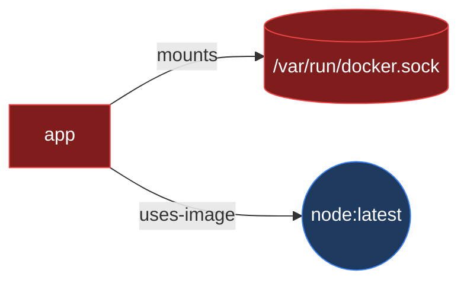

# CLI reference

Binary name: `sentinel` (package `@dl-sentinel/cli`, `apps/cli`). Build the workspace
(`npm run build`) and run `node apps/cli/dist/main.js <command>`, or invoke `sentinel`
once the package is installed.

Global flags: `--help` / `-h` prints usage to stdout and exits `0`; `--version` prints the
version and exits `0`. Progress output is written to stderr (only when stderr is a TTY and
`--quiet` is not set) so that `--format json` on stdout stays machine-parseable.

## Commands

### `sentinel scan <target>`

Scans a directory with the registered scanners and prints a report.

| Flag | Value | Meaning |
| --- | --- | --- |
| `--config <path>` | file path | Use an explicit `sentinel.yml` instead of discovering one in the target. |
| `--format <format>` | `terminal` \| `json` \| `sarif` \| `markdown` | Output format. Defaults to `terminal`. |
| `--output <path>` | file path | Write the report to a file instead of stdout. |
| `--scanners <ids>` | comma-separated scanner ids | Run only this subset of registered scanners. |
| `--fail-on <severities>` | comma-separated severities | Override `policy.failOn` for this run. |
| `--baseline <path>` | file path | Compare against a baseline and report only findings not already in it. |
| `--write-baseline <path>` | file path | Write a baseline of this scan's findings after reporting. |
| `--plugin <spec>` | file path or package name | Load an external scanner plugin. Repeatable — see [Loading external scanners](#loading-external-scanners---plugin). |
| `--quiet` | flag | Suppress the stderr progress output (and the `--write-baseline` summary line). |
| `--no-color` | flag | Disable ANSI color (also honored via `NO_COLOR` and auto-off when not a TTY). |

An unknown `--scanners` id or `--fail-on` severity is a usage error (exit `64`). A `--baseline`
file that is missing, not JSON, or not a valid baseline is likewise a usage error (exit `64`); its
contents are never echoed into the error message.

**Baseline semantics.** With `--baseline <path>`, findings already present in the baseline are set
aside and the report shows only the **new** findings (`report.findings`), plus a
`report.baseline = { newFindings, baselined }` summary. The policy — and therefore the exit code —
is then evaluated against the new findings only, so a target with pre-existing (baselined) issues
still exits `0` as long as nothing new appeared. Suppression (`suppress:` in config) is applied by
the engine first; the baseline comparison runs on those already-suppressed findings. Combining
`--baseline` and `--write-baseline` regenerates: the report reflects only new findings, while the
freshly written baseline captures the full current set. Produce a baseline with
[`sentinel baseline`](#sentinel-baseline-target) or with `--write-baseline`.

Examples:

```bash
sentinel scan .                       # scan a directory with defaults
sentinel scan ./project --config sentinel.yml
sentinel scan . --format json|sarif|markdown|terminal
sentinel scan . --output report.json  # write to file instead of stdout
sentinel scan . --scanners secrets,dependencies
sentinel scan . --fail-on critical,high
sentinel scan . --baseline .sentinel-baseline.json        # fail only on new findings
sentinel scan . --write-baseline .sentinel-baseline.json  # scan and (re)write a baseline
```

### `sentinel baseline [target]`

Scans the target and writes a **baseline** — a saved set of the current findings' stable
fingerprint ids — so a later `sentinel scan --baseline <path>` reports only findings introduced
afterwards. This is the common way to adopt DL Sentinel on an existing codebase without having to
fix every pre-existing issue first.

| Flag | Value | Meaning |
| --- | --- | --- |
| `--config <path>` | file path | Use an explicit `sentinel.yml` instead of discovering one in the target. |
| `--scanners <ids>` | comma-separated scanner ids | Run only this subset of registered scanners. |
| `--output <path>` | file path | Baseline file to write. Defaults to `.sentinel-baseline.json` in the target directory. |
| `--plugin <spec>` | file path or package name | Load an external scanner plugin. Repeatable. |
| `--quiet` | flag | Suppress the "wrote N findings" summary line on stderr. |
| `--no-color` | flag | Disable ANSI color. |

The baseline JSON is written to the file only; a one-line summary (how many findings were recorded)
goes to stderr unless `--quiet`. Findings suppressed by config never enter the baseline.

Exit codes: `0` on success, `2` on a write error, `64` on a usage error. Note that `baseline` does
**not** apply the policy — it always exits `0` when the file is written, regardless of severities.

```bash
sentinel baseline .                                  # writes ./.sentinel-baseline.json
sentinel baseline ./project --output baseline.json   # explicit output path
sentinel scan . --baseline baseline.json             # later: report only new findings
```

### `sentinel graph [target]`

Builds the **infrastructure graph** — a deterministic model of the deployment surface
(docs/architecture.md ["## Infrastructure graph"](architecture.md#infrastructure-graph)) — from
the Compose files, Kubernetes manifests, and Dockerfiles found under a directory (default: `.`),
and prints it as JSON or a [Mermaid](https://mermaid.js.org/) flowchart. Unlike `scan`, this does
not load `sentinel.yml` or run any rule: the graph is purely descriptive (nodes/edges, never a
severity), built by `@dl-sentinel/scanner-infra`'s `buildInfraGraph()` from the same
Dockerfile/Compose/Kubernetes parses the infra scanner's rules use.

| Flag | Value | Meaning |
| --- | --- | --- |
| `--format <format>` | `json` \| `mermaid` | Output format. Defaults to `json`. |
| `--output <path>` | file path | Write the graph to a file instead of stdout. |

Nodes have kind `service \| workload \| container \| image \| volume \| network \| hostPath \|
port`; edges have kind `uses-image \| mounts \| exposes \| connects \| depends-on \|
host-network \| privileged`. A compose service that both tags and `build:`s an image is
best-effort linked to the Dockerfile in its build context, so an unpinned/risky base image
shows up even when the compose file itself only names the tag it produces. When nothing is
found, a note is printed to stderr and an empty-but-valid graph (`{"nodes":[],"edges":[]}`, or
`flowchart LR` alone) is still written to stdout (or `--output`) — this is not an error.

```bash
sentinel graph .                              # JSON graph of the current directory, to stdout
sentinel graph ./project --format mermaid     # a flowchart, to stdout
sentinel graph . --format mermaid --output infra.mmd
```

Example Mermaid output (privileged/host-mounted/host-networked nodes are styled `risky`; images,
volumes, and ports get distinct shapes):



Exit codes: `0` ok (including an empty graph) · `2` write error · `64` usage error (unknown
flag/format, more than one path, or a target that doesn't exist / isn't a directory).

### `sentinel rules`

Lists every rule from every registered scanner. See [Rules](rules.md#listing-rules-sentinel-rules).
With `--plugin <spec>` (repeatable) the plugin's rules are listed after the built-ins.

```bash
sentinel rules
sentinel rules --plugin dl-sentinel-plugin-acme
```

### `sentinel plugins`

Loads the external scanner plugins given with `--plugin` and lists what each would contribute —
id, name, version, rule count and the file or package actually resolved — **without scanning
anything**. This is the command for reviewing a plugin before you use it.

| Flag | Value | Meaning |
| --- | --- | --- |
| `--plugin <spec>` | file path or package name | Plugin to load. Repeatable; at least one is required. |
| `--format <format>` | `terminal` \| `json` | Output format. Defaults to `terminal`. |
| `--no-color` | flag | Disable ANSI color. |

`--format json` emits `[{ id, name, version, categories, rules, spec, source }]`, where `source`
is the resolved file path (or the package specifier). Running it with no `--plugin` prints a note
about where plugins come from and exits `64`.

```bash
sentinel plugins --plugin ./plugins/acme/dist/index.js
sentinel plugins --plugin dl-sentinel-plugin-acme --format json
```

Exit codes: `0` ok, `64` usage error (no `--plugin`, unresolvable spec, invalid plugin).

### Loading external scanners (`--plugin`)

`scan`, `baseline`, `rules` and `plugins` accept a repeatable `--plugin <spec>`. A spec starting
with `.` or `/`, or ending in `.js`/`.mjs`/`.cjs`, is a file path resolved against the current
directory; anything else is an installed package name. Plugins register **after** the built-ins,
in flag order, and from that point are treated exactly like built-in scanners: their rules appear
in `sentinel rules`, their ids are valid in `--scanners` and in `sentinel.yml`'s `scanners:`
section, and their findings are reported, baselined and counted toward `policy.failOn` normally.

```bash
sentinel scan . --plugin ./plugins/acme/dist/index.js
sentinel scan . --plugin dl-sentinel-plugin-acme --plugin @acme/dl-sentinel-plugin-infra
sentinel scan . --plugin dl-sentinel-plugin-acme --scanners acme
```

Any load problem — unresolvable spec, a module that throws while importing, a malformed plugin, a
duplicate id, or an id already taken by a built-in — is a usage error (exit `64`) reported before
any scanning starts.

**`--plugin` is the only way the CLI loads a plugin.** A `plugins:` key in `sentinel.yml` is
ignored with a warning, including with an explicit `--config`, because config files travel inside
scanned repositories and a scanned repository must never be able to execute code through the
scanner. A plugin runs with this tool's privileges — only load code you have reviewed. See
[Plugins](plugins.md).

### `sentinel version`

Prints the tool name and version (`DL Sentinel` / `0.1.0` today, from `TOOL_NAME` /
`TOOL_VERSION` in `@dl-sentinel/core`). Add `--format json` for a machine-readable
`{ "name", "version" }` object.

```bash
sentinel version
sentinel version --format json
```

`sentinel rules` also accepts `--format terminal|json`, `--scanners <ids>` and `--plugin <spec>`.

### `sentinel report <file>`

Re-renders a previously saved JSON report in another format, without re-scanning. An input
that does not parse as a `Report` is a usage error (exit `64`).

| Flag | Value | Meaning |
| --- | --- | --- |
| `--format <format>` | `terminal` \| `json` \| `sarif` \| `markdown` | Output format. |
| `--output <path>` | file path | Write the rendered report to a file instead of stdout. |

```bash
sentinel report scan.json --format markdown
```

## Terminal output

```text
DL Sentinel v0.1.0

Scanning: ./project

secrets          2 findings
dependencies     5 findings
source           8 findings
infra            1 finding

Critical: 1
High:     5
Medium:   7
Low:      3
Info:     0

Scan completed.
```

This shape is produced by `renderTerminal()` in `@dl-sentinel/reporting`, which is already
implemented and tested — per-scanner finding counts, then a severity summary, then any scanner
errors, then a closing line.

## Output formats

`terminal`, `json`, `markdown`, and `sarif` renderers live in `@dl-sentinel/reporting`
(`packages/reporting/src`) and the CLI selects among them with `--format`. SARIF output
targets SARIF 2.1.0; severity maps to SARIF level as follows (see
[Finding schema](finding-schema.md#sarif-mapping-reporting)):

| Severity | SARIF level |
| --- | --- |
| critical, high | error |
| medium | warning |
| low, info | note |

## Exit codes

| Code | Meaning |
| --- | --- |
| `0` | Scan ok and policy passed |
| `1` | Policy violated (findings at a fail-on severity) |
| `2` | Scan or internal error |
| `64` | Usage error |

CI is expected to use these directly — see [Getting started: using DL Sentinel in
CI](getting-started.md#using-dl-sentinel-in-ci).
